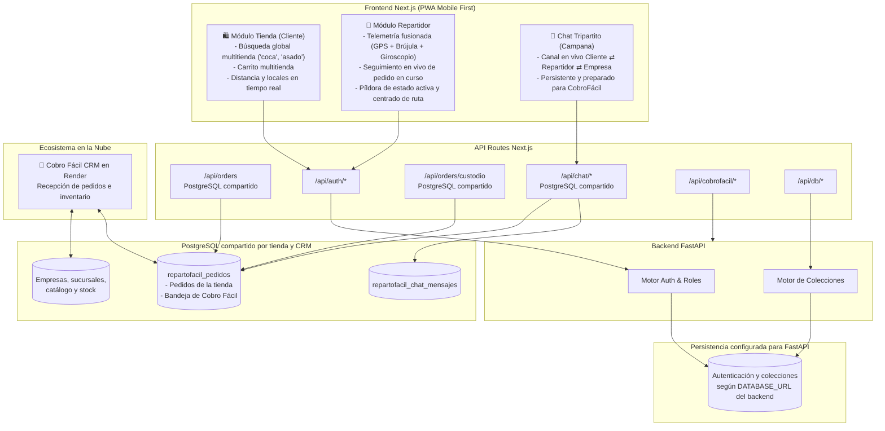

# 🚀 Arquitectura Integral y Roadmap: RepartoFácil + CobroFácil

> **Visión**: Crear una plataforma de logística y comercio de última milla hiperlocal, rápida y desacoplada, donde conviven tres actores esenciales: **Empresas/Comercios** (gestionados con CobroFácil), **Repartidores** (con telemetría sensorial y despacho inteligente) y **Clientes Finales** (experiencia de compra multitienda unificada).

---

## 🏗️ 1. Arquitectura del Sistema y Separación de Roles

La tienda Next.js, la API FastAPI y Cobro Fácil son servicios separados. La
tienda y Cobro Fácil comparten PostgreSQL para los pedidos, pero cada servicio
debe recibir su propia variable `DATABASE_URL` en Render. La API de pedidos de
la tienda consulta PostgreSQL desde `src/lib/db.ts`; no depende de la SQLite
local que FastAPI puede usar en desarrollo. Para el estado operativo, las
limitaciones y las mejoras prioritarias, consultar [PRODUCCION.md](./PRODUCCION.md).

---

## 🎯 2. Los 3 Pilares del Flujo de Trabajo

### Pilar A: Ecosistema Multitienda y Búsqueda Federada ("Buscar Coca")
- **Problema resuelto**: Anteriormente, la tienda solo mostraba el catálogo del local seleccionado (ej. carnicería).
- **Solución implementada**:
  - Al escribir un término de búsqueda (ej. `"coca"`, `"fernet"`, `"asado"`), el motor busca a lo largo de **todas** las empresas activas del ecosistema.
  - Cada tarjeta de producto (`TarjetaProducto.tsx`) muestra la **Empresa Proveedora** (ej. `🏪 Kiosco Al Toque - 24hs` o `🏪 Frigorífico Maciel`) y una **Distancia aproximada** (ej. `0.8 km`, `1.2 km`).
  - El modal de comercios (`ModalMercados.tsx`) clasifica por categorías (Carnicerías, Kioscos 24hs, Almacén) y filtra en tiempo real qué comercio tiene disponibilidad de los productos consultados.

### Pilar B: Telemetría y Seguimiento en Vivo del Repartidor
- **Fusión Sensorial**: Motor en segundo plano (`telemetryEngine.ts` y `useDriverGps.ts`) que combina:
  - **GPS de alta precisión** (latitud, longitud, altitud y cálculo de rumbo por azimut geodésico cuando la velocidad > 4 km/h).
  - **Magnetómetro / Brújula Digital** (`deviceorientationabsolute` o `webkitCompassHeading` con interpolación circular vectorial y filtro exponencial EMA cuando la velocidad ≤ 4 km/h o el repartidor está quieto).
- **Píldora de Pedido Activo en Curso (`DriverTopBar.tsx`)**:
  - Si el repartidor tiene un pedido asignado (`#RF-7420`), la barra superior muestra el estado con un punto verde pulsante en tiempo real: `[🚚 #RF-7420 · EN CURSO]`.
  - Al presionar esta píldora, la vista enfoca suavemente el mapa en el repartidor y el destino, abriendo el panel de navegación de la ruta.

### Pilar C: Comunicación Tripartita en Vivo (Campana de Notificaciones)
- **Componente**: `OrderChatSheet.tsx` acoplado al botón de la **Campana** en la barra superior.
- **Participantes**:
  1. **Repartidor**: Notifica demoras, salidas y llegada a puerta.
  2. **Cliente**: Aclara detalles de entrega (timbre, departamento, instrucciones de entrega sin contacto).
  3. **Empresa (CobroFácil)**: Avisa cuando el paquete está empacado, factura emitida o faltantes de stock.
- **Preparado para CobroFácil**: Expone endpoints de integración y webhook para que el backend de CobroFácil en Render (`https://cobrofacil.onrender.com`) pueda inyectar mensajes de sistema automáticos (ej. "Factura A #0001-00049281 generada", "Pedido embalado en mostrador").

---

## 🗺️ 3. Hoja de Ruta (Roadmap) - Hacia Dónde Vamos

### Fase 1: Consolidación Local y PWA 100% (Completada ✅)
- [x] Motor de telemetría y orientación con brújula física del móvil.
- [x] Service Worker, Web App Manifest y assets táctiles PWA.
- [x] Separación de perfiles y roles de Clientes y Repartidores.
- [ ] Persistencia y recuperación confiables de cuentas y sesiones del backend.
- [x] Catálogo multi-empresa con búsqueda global cruzada y visualización de distancias.
- [x] Chat tripartito y píldora de pedido en curso en el mapa.

### Fase 2: Sincronización WebSockets / SSE en Vivo (Próximo Sprint 🚀)
- [ ] Implementar endpoint WebSocket bidireccional `/ws/orders/{order_id}` en FastAPI.
- [ ] Transmisión en tiempo real (cada 2 segundos) de la posición `(lat, lng, heading)` del repartidor hacia el visor del cliente.
- [ ] Notificaciones Push PWA (Web Push API) para avisos de entrega y mensajes nuevos de la campana.

### Fase 3: Integración Profunda con CobroFácil (Render)
- [ ] Webhook entrante desde `https://cobrofacil.onrender.com`:
  - `POST /api/webhooks/cobrofacil/order-ready` ➔ Dispara automáticamente la oferta de pedido a los repartidores cercanos.
  - Sincronización de stock en tiempo real: Si un comercio vende la última Coca-Cola en su caja registradora de CobroFácil, se oculta instantáneamente en la tienda web de RepartoFácil.

### Fase 4: Despacho Automatizado por Proximidad (Matching Inteligente)
- [ ] Algoritmo Voronoi / Haversine en backend para asignar pedidos al repartidor con menor tiempo estimado de llegada (ETA).
- [ ] Modo de navegación guiada paso a paso por voz en el PWA para el repartidor (MapLibre / OSRM routing).

---

## 🔒 4. Accesos de Prueba

No guardar contraseñas ni tokens en el repositorio. Consultar las cuentas de
prueba desde el entorno autorizado y no utilizar credenciales reales para
verificar cambios de interfaz.
