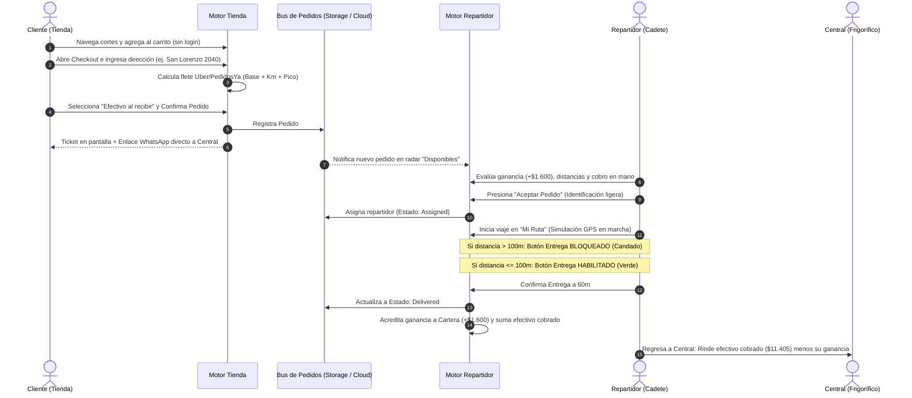

# Especificación y Estructura de la Lógica de Negocio — Reparto Fácil

**Ecosistema:** Reparto Fácil · Frigorífico Maciel  
**Ubicación:** `src/modulos/logica_negocio.md`  
**Objetivo:** Definir de manera formal, estructurada y verificable todas las reglas de negocio, modelos financieros, máquinas de estado y protocolos de seguridad del e-commerce y su logística de última milla.

---

## 1. Visión y Fundamentos del Modelo de Negocio

Reparto Fácil combina dos experiencias en una sola plataforma web progresiva (PWA):
1. **La Tienda Cárnica (Comprador / Familias):** Catálogo abierto con cortes vacunos, de cerdo, pollo, achuras, carbón y combos parrilleros con precios por kilo y por unidad.
2. **El Módulo Logístico (Repartidor / Cadetes):** Plataforma operativa para motomensajeros con radar de pedidos, métricas de rentabilidad por viaje, geocerca de seguridad y billetera virtual en tiempo real.

### Principio Rector: Cero Fricción Inicial (Zero-Friction Onboarding)
A diferencia de plataformas cerradas que exigen registro antes de ver productos o evaluar viajes, Reparto Fácil adopta el estándar de alta conversión:
- **En la Tienda:** El cliente navega, filtra, busca y arma su carrito sin cuenta previa. Los datos personales y de envío se solicitan **únicamente al momento de pagar** (Just-in-Time Checkout).
- **En el Repartidor:** El cadete puede ver el mapa de demanda, los pedidos disponibles, las distancias y las ganancias estimadas libremente. La identificación (nombre y vehículo) se solicita **únicamente al presionar "Aceptar Pedido"**.

---

## 2. Matriz de Actores y Flujo de Interacción



---

## 3. Motor Tarifario y Algoritmo de Precios (Estándar Uber / PedidosYa)

El cálculo del costo de envío y la ganancia del repartidor se rige por un motor de precios dinámicos ubicado en `src/modulos/tienda/motor/tarifaUberService.ts`:

### 3.1. Fórmula del Envío al Comprador
$$\text{Costo de Envío} = (\text{Tarifa Base} + (\text{Distancia en KM} \times \text{Precio por KM})) \times \text{Multiplicador Horario Pico}$$

* **Tarifa Base:** `$1.200` (cubre costos operativos fijos de despacho y preparación).
* **Precio por KM:** `$450 / km`. La tarifa actual obtiene una distancia aproximada mediante coincidencias de direcciones conocidas en `estimateAddressCoords()`; para direcciones no reconocidas usa una distancia predeterminada. `haversineKm()` es una utilidad disponible, pero el cálculo de tarifa no geocodifica cada domicilio en tiempo real.
* **Multiplicador Horario Pico:**
  * **Horario Normal:** `1.00x` (sin recargo).
  * **Horario Pico:** `1.35x` (+35% de recargo dinámico). Se activa automáticamente en los turnos de alta demanda:
    * *Almuerzo:* 12:00 a 14:30 hs.
    * *Cena:* 20:00 a 23:30 hs.

### 3.2. Política de Envío Gratis
* **Umbral de compra:** Si el subtotal de la compra es igual o superior a **`$35.000`**, el costo de envío para el cliente es **`$0` (GRATIS)**.
* **Subsidio de la Empresa:** El repartidor **NO pierde su ingreso**. Frigorífico Maciel absorbe el costo del flete para incentivar compras de volumen, garantizando el pago íntegro al repartidor.

### 3.3. Algoritmo de Ganancia del Repartidor (Driver Payout)
* **Porcentaje del flete:** El repartidor percibe el **`85%`** del valor total del envío generado.
* **Piso Mínimo Garantizado:** Ningún viaje paga menos de **`$1.600`**.
$$\text{Ganancia Repartidor} = \max(\$1.600, \; \text{round}(\text{Costo Envío} \times 0.85))$$

---

## 4. Máquina de Estados del Pedido (Order State Machine)

Los pedidos siguen un ciclo de vida unidireccional y predecible:

| Estado | Significado Operativo | Quién lo Transiciona | Visibilidad en Tienda | Visibilidad en Repartidor |
| :--- | :--- | :--- | :--- | :--- |
| **Pending** | Pedido creado por cliente, pendiente de asignación. | Cliente al confirmar checkout. | "Pedido en preparación" | Pestaña **"Disponibles"** en radar. |
| **Assigned** | Tomado por un cadete que ya ingresó sus datos. | Repartidor al presionar "Aceptar Pedido". | "Repartidor asignado" | Pasa a pestaña **"Mi Ruta"**. |
| **Picked Up** | Mercadería retirada del frigorífico en `Tucumán 2130`. | Repartidor al iniciar viaje. | "En camino al domicilio" | "Mi Ruta" con velocímetro activo. |
| **In Transit** | Navegación activa hacia el domicilio del cliente. | Telemetría GPS en marcha. | "En viaje" | GPS con cuenta regresiva de metros. |
| **At Destination** | Repartidor situado a menos de 100 metros del destino. | Sensor de proximidad / Geocerca. | "Repartidor en la puerta" | Botón verde de entrega desbloqueado. |
| **Delivered** | Pedido entregado y cobrado. Fin de la orden. | Repartidor al pulsar "Confirmar Entrega". | "Pedido entregado con éxito" | Impacto inmediato en **Mi Cartera**. |
| **Cancelled** | Orden cancelada por falta de stock o anulación. | Administrador / Central. | "Cancelado" | Desaparece del radar. |

---

## 5. Regla Sagrada de Seguridad: Geocerca de 100 Metros

Inspirado en el estándar de seguridad de Uber Eats y PedidosYa, el sistema cuenta con un candado físico para evitar entregas falsas, cobros indebidos o cierres accidentales a distancia:

1. **Bloqueo a > 100 metros:**
   * Mientras la distancia calculada entre la posición GPS del repartidor y el punto de entrega sea superior a 100 metros (`distancia > 100m`), el botón de confirmación se mantiene **deshabilitado y bloqueado con candado**:
   * *Leyenda:* `ENTREGA BLOQUEADA (A X metros del domicilio)`.
2. **Desbloqueo a <= 100 metros:**
   * En el instante en que el repartidor ingresa dentro del radio de 100 metros (`distancia <= 100m`), el botón se habilita de forma automática, se ilumina en **verde esmeralda brillante** con animación de pulso y muestra el importe a cobrar en su cartera:
   * *Leyenda:* `CONFIRMAR ENTREGA (+$ X.XXX)`.

---

## 6. Billetera Virtual y Conciliación Financiera

La billetera del repartidor (`src/modulos/repartidor/motor/walletService.ts`) maneja un modelo contable de doble registro:

### 6.1. Componentes de la Cartera
1. **Ganancia Neta Disponible (`balance`):** Total de dinero ganado legítimamente por el repartidor por las entregas realizadas en su turno.
2. **Efectivo Cobrado en Mano (`cashInHand`):** Suma total del dinero físico cobrado directamente a los clientes que pagaron con modalidad *Efectivo contra entrega*. Este dinero pertenece al comercio (costo de la carne).
3. **Contador de Entregas (`completedOrdersCount`):** Cantidad de viajes finalizados.
4. **Libro Diario de Transacciones (`transactions`):** Historial con timestamp, id de orden y monto acreditado.

### 6.2. Regla de Rendición y Liquidación con la Central
Al finalizar la jornada o turno, el repartidor regresa a la sucursal de Frigorífico Maciel (`Tucumán 2130`):
$$\text{Liquidación a Rendir en Caja} = \max(0, \; \text{Efectivo en Mano} - \text{Ganancias Acumuladas})$$

* **Caso 1 (El repartidor cobró más efectivo de lo que ganó):**  
  * Efectivo en mano = `$11.405`
  * Ganancia ganada = `$1.600`
  * *Rendición:* Entrega `$9.805` al cajero del frigorífico y se queda con sus `$1.600` de propina/flete en el bolsillo.
* **Caso 2 (El repartidor hizo pedidos con pago por transferencia previa):**  
  * Efectivo en mano = `$0`
  * Ganancia ganada = `$4.800` (3 entregas)
  * *Rendición:* La central le abona `$4.800` en efectivo o transferencia bancaria directa.

---

## 7. Análisis Comparativo: Pros vs Contras y Referencias de Mercado

| Plataforma de Referencia | Ventajas Adoptadas en Reparto Fácil | Desventajas Evitadas en Reparto Fácil |
| :--- | :--- | :--- |
| **PedidosYa / Rappi** | Desglose de tarifa transparente por km, badge de horario pico y cobro en efectivo en mano. | **Evitado:** Altas comisiones del 25% al 35% que ahogan al comercio; login obligatorio antes de ver productos; retención de pagos de hasta 15 días a repartidores. |
| **Uber Eats** | Algoritmo de flete dinámico con multiplicador por demanda, geocerca estricta para liberar entrega y GPS en tiempo real. | **Evitado:** Penalizaciones algorítmicas opacas a repartidores; tarifas que varían bruscamente segundo a segundo sin aviso al comprador. |
| **Mercado Libre Envíos Flex** | Envío bonificado a partir de un ticket mínimo (`$35.000`) para incentivar compra mayorista/familiar. | **Evitado:** Obligación de entregar en franja horaria rígida de 12 horas; necesidad de escaneo de código de barras complejo en la puerta. |
| **Didi Food** | Tarifa base competitiva con piso de ingresos digno para el repartidor (`$1.600` mínimo por viaje). | **Evitado:** Falta de integración directa con WhatsApp para atención humanizada de consultas sobre cortes o maduración de la carne. |

---

## 8. Arquitectura de Archivos y Responsabilidades

```
src/modulos/
├── logica_negocio.md                     <-- Documento maestro de lógica y reglas
├── tienda/                               <-- PIRÁMIDE 1: E-commerce y Comprador
│   ├── plano.md                          <-- Arquitectura de la rama Tienda
│   ├── TiendaPiramidal.tsx               <-- Orquestador de la tienda
│   ├── motor/                            <-- Motores de datos de Tienda
│   │   ├── README.md                     <-- 5 Pilares del motor de tienda
│   │   ├── tipos.ts                      <-- Tipos de carrito, orden y checkout
│   │   ├── useCart.ts                    <-- Carrito reactivo en localStorage
│   │   ├── tarifaUberService.ts          <-- Motor de tarifas Uber/PedidosYa y Haversine
│   │   └── pedidoService.ts              <-- Creación de pedidos y puente WhatsApp
│   └── ui/                               <-- Componentes visuales de Tienda
│       ├── README.md                     <-- 5 Pilares de la UI de tienda
│       ├── HeaderTienda.tsx              <-- Logo, sucursales y cambio a repartidor
│       ├── FiltroCategorias.tsx          <-- Selector de categorías cárnicas
│       ├── TarjetaProducto.tsx           <-- Tarjetas responsive 390px
│       ├── DrawerCarrito.tsx             <-- Panel lateral de revisión
│       └── ModalCheckout.tsx             <-- Checkout, flete dinámico y cobro al recibir
│
└── repartidor/                           <-- PIRÁMIDE 2: Logística y Conductor
    ├── plano.md                          <-- Arquitectura de la rama Repartidor
    ├── RepartidorPiramidor.tsx           <-- Orquestador del modo repartidor
    ├── motor/                            <-- Motores de datos de Repartidor
    │   ├── README.md                     <-- 5 Pilares del motor de repartidor
    │   ├── tipos.ts                      <-- Tipos de órdenes, wallet y perfil
    │   ├── driverService.ts              <-- Asignación, entrega y persistencia
    │   ├── walletService.ts              <-- Billetera virtual y eventos reactivos
    │   ├── useDriverOrders.ts            <-- Hook de órdenes y radar
    │   └── useDriverGps.ts               <-- Telemetría GPS en tiempo real
    └── ui/                               <-- Componentes visuales de Repartidor
        ├── README.md                     <-- 5 Pilares de la UI de repartidor
        ├── DriverTopBar.tsx              <-- Saldo de billetera, GPS y switch
        ├── TabPedidosDisponibles.tsx     <-- Radar con ganancias y alerta de cobro
        ├── TabMiRuta.tsx                 <-- Simulación GPS y geocerca 100m
        ├── ModalDriverAuth.tsx           <-- Identificación ligera Just-in-Time
        ├── ModalCarteraRepartidor.tsx    <-- Resumen de saldo y rendición de caja
        └── DriverCopilotSheet.tsx        <-- Copiloto inteligente
```
